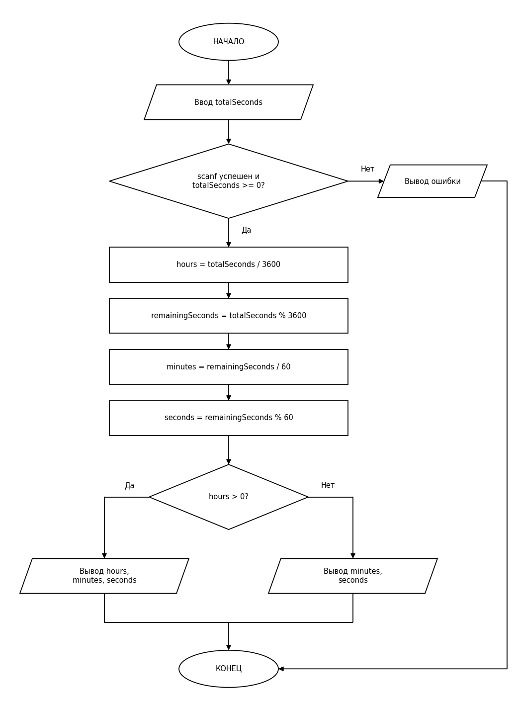

# Перевод секунд в часы, минуты и секунды

**Название:** Перевод секунд в часы, минуты и секунды

**Автор:** Сайкин Михаил Сергеевич

**Описание:** Программа запрашивает у пользователя количество секунд (целое неотрицательное число типа `long long`) и переводит его в часы, минуты и секунды. Если введено не число или отрицательное значение, выводится сообщение об ошибке и программа завершается с кодом 1. Иначе количество часов находится делением `totalSeconds / 3600`, остаток секунд `totalSeconds % 3600` делится на 60 для получения минут, а остаток от деления на 60 даёт секунды. Результат выводится с учётом условия про часы: если часов больше нуля, показываются часы, минуты и секунды, а если часов нет, то только минуты и секунды.

**Блок-схема:**

**Компиляция:** Проект создан в Visual Studio 2022. Для сборки нажмите Build Solution.

